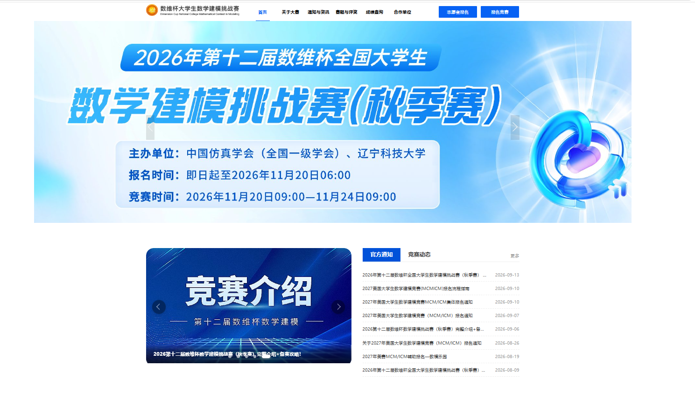

# 数维杯参赛说明

- [数维杯全国大学生数学建模挑战赛官网](https://www.nmmcm.org.cn/)

- 

  

**二、竞赛时间安排**

**报名截止：**：**2026年11月20日09:00—11月24日09:00

**竞赛时间****：**2026年11月20日09:00—11月24日09:00

**论文提交截止：**2026年11月24日10:00（逾期提交无效）

**成绩公布：**2027年1月中旬

**三、竞赛形式**

竞赛采用通讯方式，统一命题。赛题于竞赛开始时在指定官网公布，不邮寄纸质题目。参赛队须在规定时间内完成从模型建立、求解、验证到英文论文撰写的全部工作，论文为评奖主要依据。具体规则详见官网。

**四、竞赛内容与要求**

**1.****赛题设置：**设A、B、C、D四道题目，涵盖数学建模（MCM）与交叉学科建模（ICM）方向，题目来源于科学与工程技术、数据科学与人工智能、经济管理与社会科学、仿真技术等领域经适当简化加工的实际问题。各参赛队限选一题作答。

**2.****知识与技能：**参赛学生应掌握工科数学及相关专业基础知识，具备一定计算机编程能力。

**3.****论文要求：**参赛队伍仅须提交电子版PDF格式论文，无需另附纸质文件。论文文件须按统一规则命名，格式为“XSWBMCM2600001.pdf”，其中首字母“X”为题号（如A、B、C、D），后续“SWBMCM2600001”为系统分配之队伍编号（示例：ASWBMCM2600001.pdf）。论文须符合《2026年第十二届数维杯全国大学生数学建模挑战赛论文规范》，不合规范者不予评审。组委会将对全部论文进行多维原创性核查：全文疑似AIGC生成比例超过30%，或全文总相似比（含引用）超过50%的，视为雷同论文，取消评奖资格；情节严重者予以通报批评。

**五、参赛条件与报名方式**

**1.****参赛对象：**全国普通高校全日制在校生（分专科组、本科生组、研究生组）。以队为单位报名，每队1–3名学生，可设1名指导教师（允许跨校组队，不可重复组队），各校参赛队数不限。

**2.****参赛费用：**每队缴纳报名费200元，用于组织、命题、评审、赛题讲解、证书制作等开支。费用由辽宁科技大学统一收支并开具发票。

***注：涉及到出题、评阅准备等，报名截止前14天（202****6****年11月6日）起不可取消比赛。**

**3.****缴费方式：**

**1.****在线支付：**登录报名官网 https://www.mojinghub.com/competitions/swbmcm/2026在线完成。

**2.****银行汇款：**

户名：辽宁科技大学

开户行：中行鞍山高新区支行营业部

账号：306456301340

汇款附言请注明：“数维杯建模大赛+学校名称+队伍数”。

**六、奖项设置**

1.奖项设特等奖（Outstanding Winner，每道题1队，共4队，奖金1000元/队）、提名奖（Finalist）、一等奖（Meritorious Winner）、二等奖（Honorable Mention）、优秀奖（Merit Award）。其他奖励详见官网。

2.提名奖、一等奖、二等奖的获奖队数原则上分别不超过参赛队总数的2%、10%、30%。

3.获得全国优秀奖及以上的参赛者可自愿申请成为中国仿真学会“学生会员”。

4.结果公布后举办颁奖典礼，将邀请部分获奖师生代表参加。

**七、竞赛联系方式**

请所有参赛者务必进群，第一时间获取竞赛最新通知
2026官方QQ参赛群：**909700804**
大赛相关问题（寻找队友、集体报名、开具发票等）均可联系组委会老师进行咨询：
组委会官方QQ：1532597773、277558422
联系电话&微信：13948716615（刘老师，竞赛日常联络）
竞赛邮箱：**mcm@nmmcm.org.cn**
报名官网：https://mojinghub.com/competitions/swbmcm/2026
竞赛官网：https://www.nmmcm.org.cn/
**微信公众号：**数维杯数学建模竞赛组委会